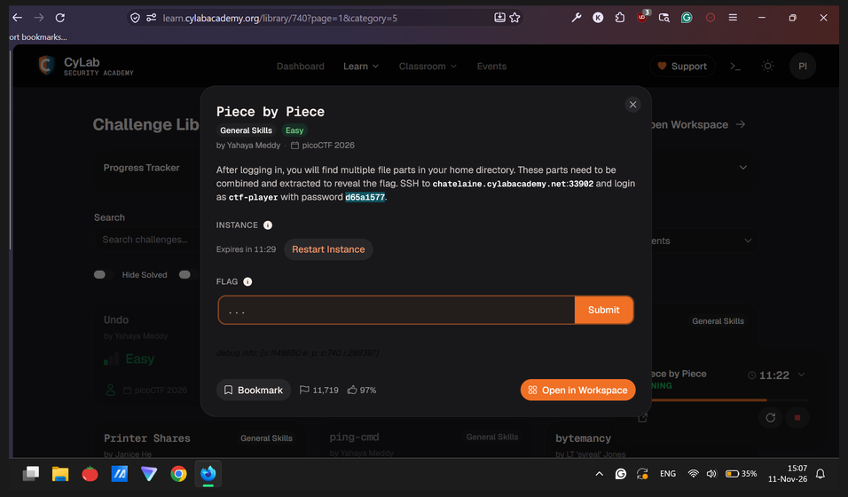
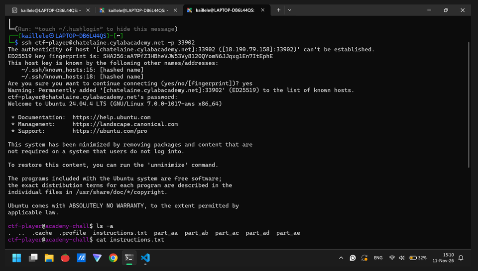
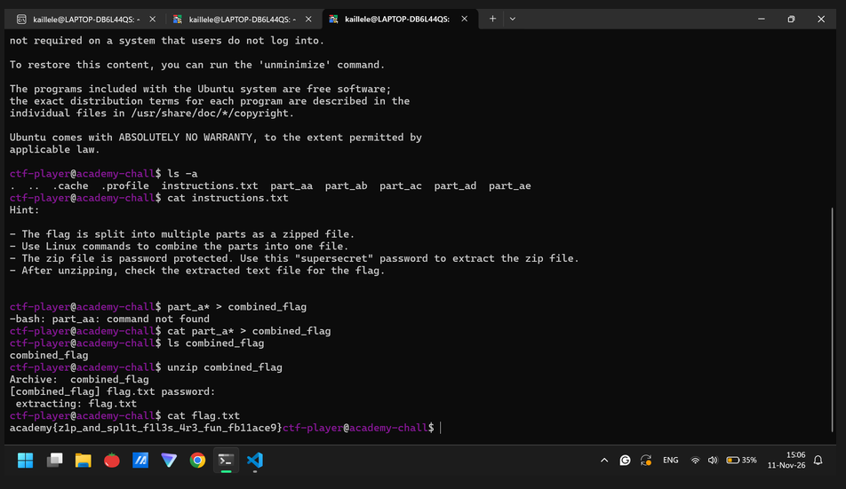

# Piece by Piece (General Skills, Easy): picoCTF 2026

| Field      | Value |
|------------|-------|
| 📅 Event      | picoCTF 2026 |
| 🗂️ Category   | General Skills |
| ⭐ Points     | N/A |
| 👥 Solves     | 11,719 |
| ✍️ Author     | Yahaya Meddy |
| 👤 Solved by  | Myself solo |
| 📊 Status     | Solved |

## ⚡ TL;DR
Just read the hints carefully, then execute all the given hints properly.

## 🎯 Challenge

- 🌐 Service: `CyLab Security Academy challenge library` 

## 👀 First look
I'm listing all files inside ctf-player “account”. And reading the instructions.

```{bash}
$ ssh ctf-player@chatelaine.cylabacademy.net -p 33902
ctf-player@academy-chall$ ls -a
$ cat instructions.txt
```

## 🛑 Dead ends
None

## 💡 Solution
### Step 1: 
Transform the improper syntax SSH command from the challenge into a proper one in order to run on Kali Linux CLI.

### Step 2:
Do “sign-in” as ctf-player with the given password using the proper SSH command.

### Step 3:
List all available files inside the ctf-player “account”. Then open and read the instructions.txt file carefully, especially for the given hints.

### Step 4:
Execute all the given hints. And then you should find a flag.


```{bash}
# solve script: Kali Linux CLIcommands
ctf-player@academy-chall$ cat part_a* > combined_flag
ctf-player@academy-chall$ unzip combined_flag
Archive:  combined_flag
[combined_flag] flag.txt password:
 extracting: flag.txt
ctf-player@academy-chall$ cat flag.txt
```



## 🚩 Flag
`academy{z1p_and_spl1t_f1l3s_4r3_fun_fb11ace9}`  

## 🧠 Lessons learned
- Execute the given hints. I have no idea actually.

## 📚 References
- NO CHATTING AI LLMs (e.g. ChatGPT, Claude, DeepSeek).
- Quick googling for SSH commands.
- You can check my Google Docs = https://docs.google.com/document/d/1ChAH7iXD1BNYaAN3f35Ro2f62CgE6Lj12yyTuIQqoTU/edit?usp=sharing

