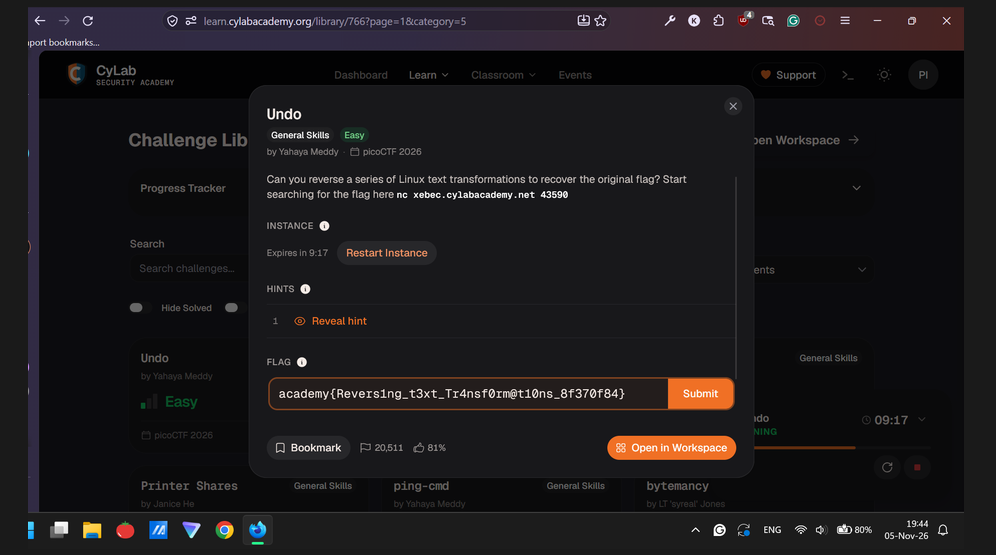
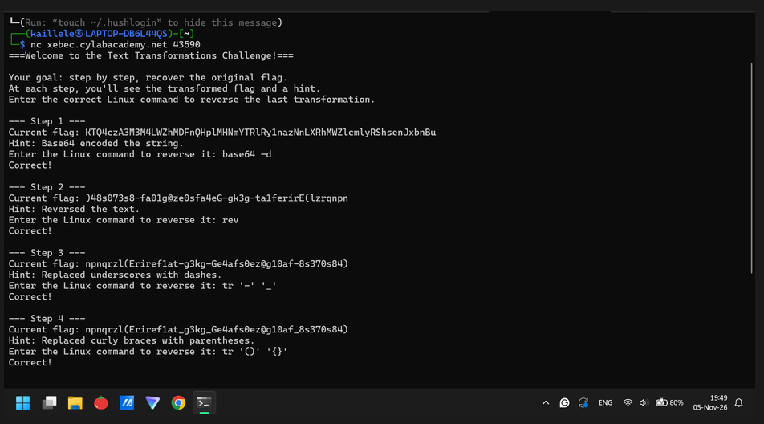
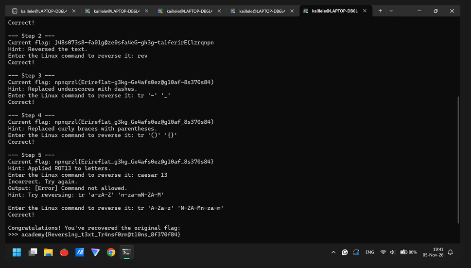

# Undo (General Skills, Easy): picoCTF 2026

| Field      | Value |
|------------|-------|
| Event      | picoCTF 2026 (CyLab Security Academy challenge library) |
| Category   | General Skills, Easy |
| Points     | N/A |
| Solves     | 20,512 |
| Author     | Yahaya Meddy |
| Solved by  | Myself solo |
| Status     | Solved |

## TL;DR
Just listen and execute all the given hints to get a flag.

## Challenge

- Service: `xebec.cylabacademy.net 43590` (CyLab Security Academy website)

## First look

```
$ nc xebec.cylabacademy.net 43590
```

## Dead ends
- None

## Solution
### Step 1: Input linux command of Base64 encoding
Because it asks. So I just input it the Linux command of Base64 encoded through quick googling.

### Step 2: Follow all the hints and input the Linux command
Just follow those hints and googling the Linux command of it.
```{python}
# solve script: None

```


## Flag
`academy{Revers1ng_t3xt_Tr4nsf0rm@t10ns_8f370f84}` 

## Lessons learned
- Listens to and executes all the given hints to get a flag.

## References
- Only quick googling for the Linux command. NO CHATTING WITH AI LLM (e.g. ChatGPT, Claude, DeepSeek, etc.)
- Thanks to the write-up template and guide from https://ctf7.com/learn/how-to-write-a-ctf-writeup/#writeup-template
- You may check my Google Docs = https://docs.google.com/document/d/1q7wKCQqPWuwwbVK8DR7tSWsbiYz5SQ4YAerFTtdrrVU/edit?usp=sharing

