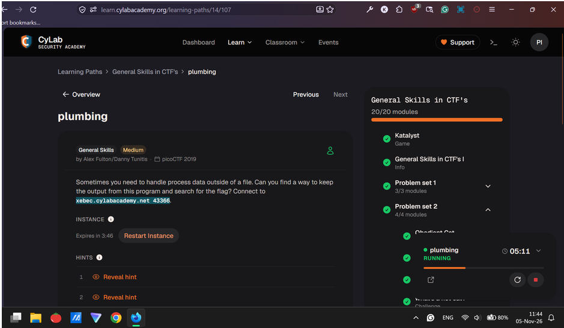
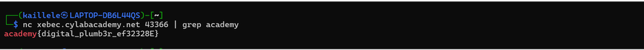

# plumbing (General Skills, Medium): picoCTF 2019

| Field      | Value |
|------------|-------|
| Event      | picoCTF, 2019 |
| Category   | General Skills, Medium |
| Points     | N/A |
| Solves     | 57,621 |
| Author     | Alex Fulton/Danny Tunitis |
| Solved by  | Myself solo |
| Status     | Solved |

## TL;DR
Use command nc and then pipe to the grep command 

## Challenge

- Files: xebec.cylabacademy.net 43366.
- Service: CyLab Security Academy website

## First look
I checked using the netcat command and tried piping to the grep command

```
$ nc xebec.cylabacademy.net 43366
```

## Dead ends
- N/A

## Solution
### Step 1:
```
nc xebec.cylabacademy.net 43366 | grep academy
```
### Step 2:
Boom, found it!



```python
# solve script: N/A
print(“Nothing”)
```

## Flag
`academy{digital_plumb3r_ef32328E}`  

## Lessons learned
- I'm very lazy to write this hehehe. Maybe next time =)

## References
- Tysm for the CTF write-up template https://ctf7.com/learn/how-to-write-a-ctf-writeup/
- You can check for my own write-up on Google Docs here = https://docs.google.com/document/d/1fhL6uZjZ8NXTp11x0sS4kO2hALMt-08Eu_S1Gd1TE7o/edit?usp=sharing


