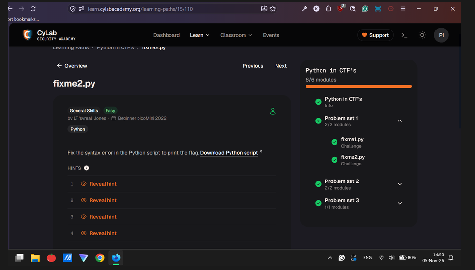
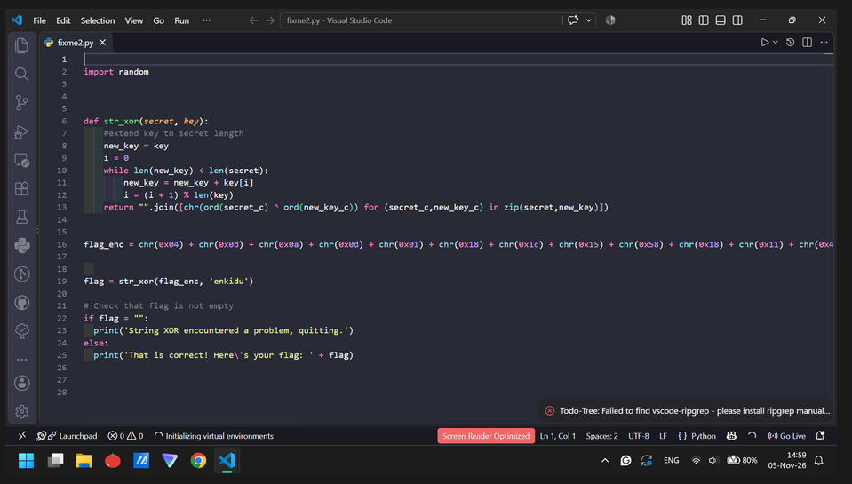
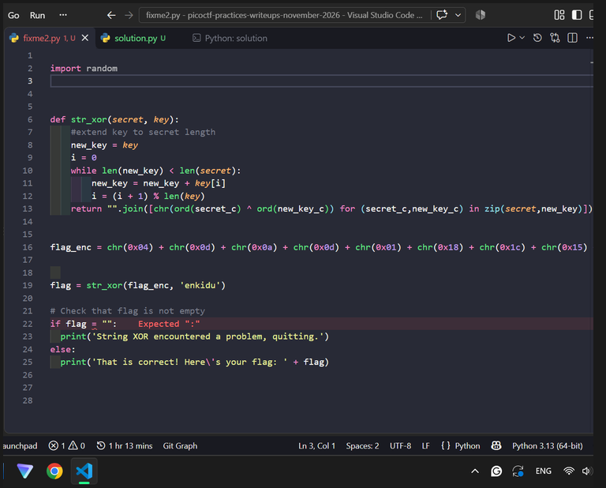
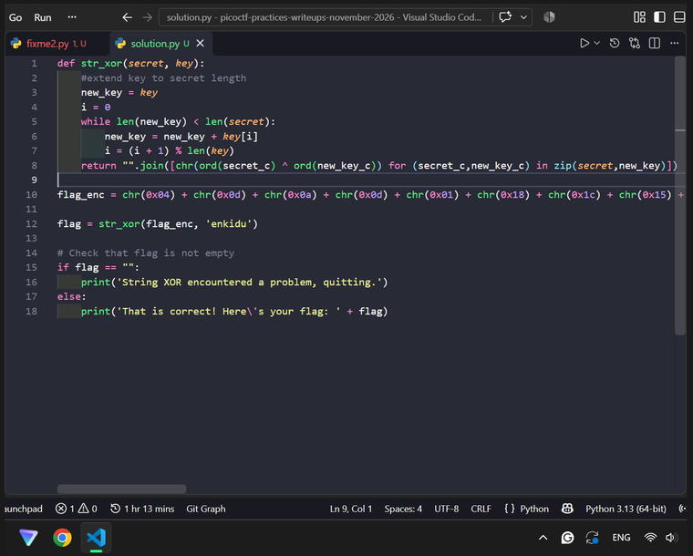

# fixme2.py (General Skills, Easy): Beginner picoMini 2022

| Field      | Value |
|------------|-------|
| Event      | Beginner picoMini 2022 (CyLab Security Academy) |
| Category   | General Skills |
| Points     | None |
| Solves     | 71,097 |
| Author     | LT 'syreal' Jones |
| Solved by  | Myself solo |
| Status     | Solved |

## TL;DR
Fix the given Python code error by adding “==”. Keep an eye on proper Python syntax.

## Challenge


- Files: `fixme2.py` 
- Service: `https://learn.cylabacademy.org/learning-paths/15/110` (CyLab Security Academy website)

## First look

```
None
```

## Dead ends
- None

## Solution
### Step 1:
I open VS Code for the given Python file directly. I inspect the “typo” in the Python code.

### Step 2: 
Correct the “typo” to proper Python syntax. Then run the corrected Python file.

```{python}
# solve script: N/A
def str_xor(secret, key):
    #extend key to secret length
    new_key = key
    i = 0
    while len(new_key) < len(secret):
        new_key = new_key + key[i]
        i = (i + 1) % len(key)        
    return "".join([chr(ord(secret_c) ^ ord(new_key_c)) for (secret_c,new_key_c) in zip(secret,new_key)])


flag_enc = chr(0x04) + chr(0x0d) + chr(0x0a) + chr(0x0d) + chr(0x01) + chr(0x18) + chr(0x1c) + chr(0x15) + chr(0x58) + chr(0x18) + chr(0x11) + chr(0x41) + chr(0x09) + chr(0x5f) + chr(0x1f) + chr(0x10) + chr(0x3b) + chr(0x1b) + chr(0x55) + chr(0x1a) + chr(0x34) + chr(0x5d) + chr(0x51) + chr(0x40) + chr(0x54) + chr(0x09) + chr(0x05) + chr(0x04) + chr(0x57) + chr(0x1b) + chr(0x11) + chr(0x31) + chr(0x5c) + chr(0x0d) + chr(0x06) + chr(0x11) + chr(0x5d) + chr(0x5b) + chr(0x5e) + chr(0x0f) + chr(0x19)


flag = str_xor(flag_enc, 'enkidu')


# Check that flag is not empty
if flag == "":
    print('String XOR encountered a problem, quitting.')
else:
    print('That is correct! Here\'s your flag: ' + flag)

```


## Flag
`academy{3qu4l1ty_n0t_4551gnm3nt_7dbd855f}` 

## Lessons learned
- Inspect all the given files first
- Keep an eye on silly “typos” in programming syntax.

## References
- NO AI & NO GOOGLING REAL
- Tysm for the template and guide from (https://ctf7.com/learn/how-to-write-a-ctf-writeup/#portfolio) for writing this write-up.
