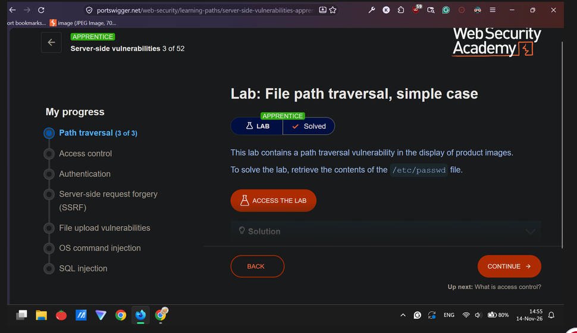
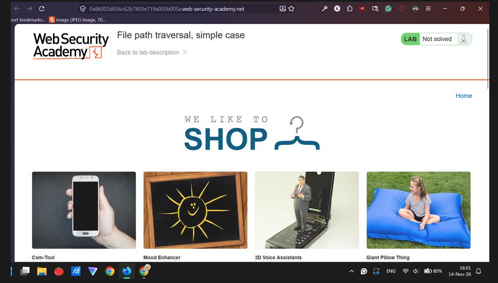
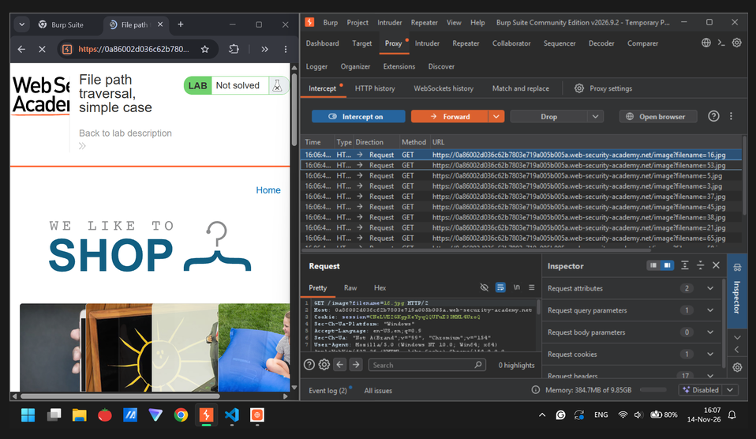
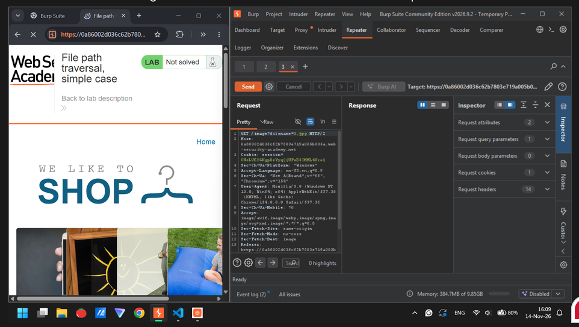
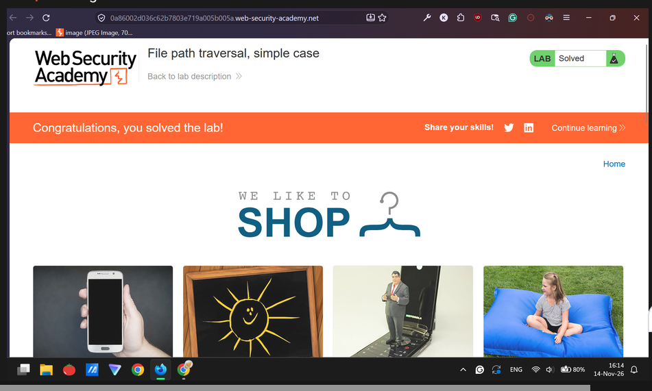

# Lab: File path traversal, simple case (Server-side vulnerabilities 3 of 52, Apprentice) 

| Field      | Value |
|------------|-------|
| 📅 Event      | N/A |
| 🗂️ Category   | Web Exploitation, Apprentice |
| ⭐ Points     | N/A |
| 👥 Solves     | N/A |
| ✍️ Author     | N/A |
| 👤 Solved by  | Myself solo |
| 📊 Status     | Solved |

## ⚡ TL;DR
Use Burp Suite Community Edition and then edit the filename to file path traversal “../../../../etc/passwd”. Actually I have no idea lol =)

## 🎯 Challenge

- 🌐 Service: `https://portswigger.net/web-security/learning-paths/server-side-vulnerabilities-apprentice/path-traversal-apprentice/file-path-traversal/lab-simple#` 

## 👀 First look

## 🛑 Dead ends
- I have no idea if it is required to utilize Burp Suite Community Edition to solve it. “Culture Shock”.

## 💡 Solution
### Step 1: 
Initialize Burp Suite’s software and browser.

### Step 2: 
Click a random image file and then click Send to Repeater.

### Step 3:
Edit the filename to ../../../../../etc/passwd from concept File Path Traversal. I have no idea, actually.

## 🚩 Flag

## 🧠 Lessons learned
- Use Burp Suite Community Edition.

## 📚 References
- Peeking at a quick solution a bit hehehe.
- You can check my Google Docs = https://docs.google.com/document/d/13-xLXzCZvYN_S5UUMiSGMwq6TZXIORQ0BOpRb3zp92Y/edit?usp=sharing

